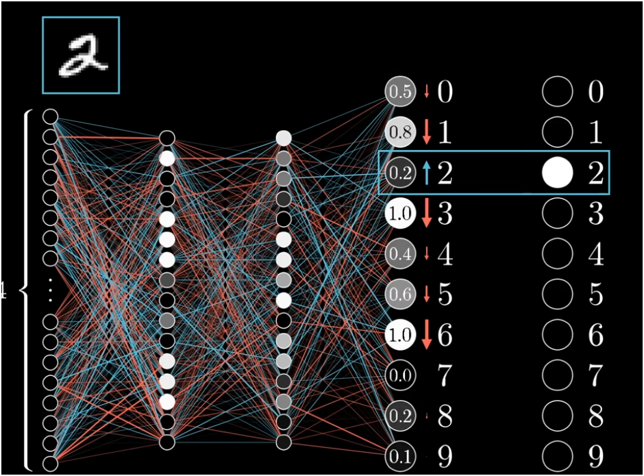
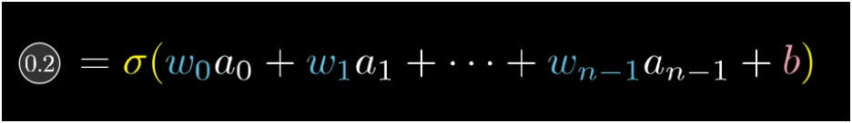

# Backpropagation

## What's Backpropagation?
It's an algorithm for calculating the gradients of the loss function with respect to the weights and biases in an artificial neural network.

Stacking multiple TLU layers creates a **Multi-Layer Perceptron (MLP)** consisting of an input layer, one or more hidden layers, and an output layer.

---

## Random Weight Initialization
It is important to initialize all the hidden layers’ connection weights randomly, or else training will fail. For example, if you initialize all weights and biases to zero, then all neurons in a given layer will be perfectly identical, and thus backpropagation will affect them in exactly the same way, so they will remain identical.

---

## The 4-Step Training Loop
1. **Forward Propagation (Making a Prediction):** A mini-batch of input nodes crosses the layers where it is affected by weighted sums, activations of the said nodes, and biases, making its way to the final product while saving intermediate layer outputs.
2. **Loss Computation:** Once output is made, the network compares its prediction to the true target label using a loss function to calculate the output error.
3. **Backpropagation / Reverse Pass (Tracking Down Errors):** Applies the calculus **chain rule** backward from the output layer—we nudge the node by altering the past layer's weights and biases, and so on all the way back to the input layer, to calculate error gradients across all weights.
4. **Gradient Descent Step:** Adjusts all connection weights and biases in the opposite direction of the gradients.

---

## How Backpropagation Nudges the Network

### 1. Output Node Changes
The size of changes needed for each output node depends on the desired outcome: some nodes we really need to ensure pass the threshold and activate to `1.0`, while other nodes we ought to reduce—and that's for one input.

### 2. Three Ways to Increase/Change a Neuron's Output
Increasing the output is done through the weight, the activation reading plus bias, and the Sigmoid or ReLU:
* **Can increase bias**
* **Can increase weight**
* **Can alter or change the past layer's activation layer** — since we have no direct control over the activation layer itself, we alter it indirectly by nudging the previous layer's weights and biases.

### 3. Hebbian Theory
* *"Neurons that wire together fire together"* (wdym?):
* Neurons that are sending stronger signals are related to the output that reads the positive output—so changing weights connected to those brighter, more active neurons gives the biggest nudge.

### 4. Propagating Backward Across All Layers & Mini-Batches
Take in mind that we're still altering the output of one desired node—we still need to work on the other output nodes that can give different readings.
* **Summing & Iterating Backward:** That's where propagating backward comes in—ending up with the total nudges that we want to have for the last layer (by summing the nudges from every output node), so we **recursively iterate the functions** all the way back to the input layer.
* **Mini-Batching (Stochastic Gradient Descent):** Instead of doing this over the whole dataset at once, we shuffle the data into mini-batches, then compute a backpropagation step for each mini-batch—each mini-batch aids us in stepping downhill toward the lower point, which is called **Stochastic Gradient Descent**.
