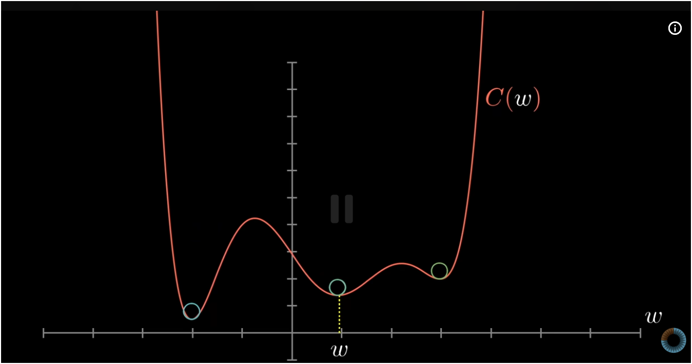
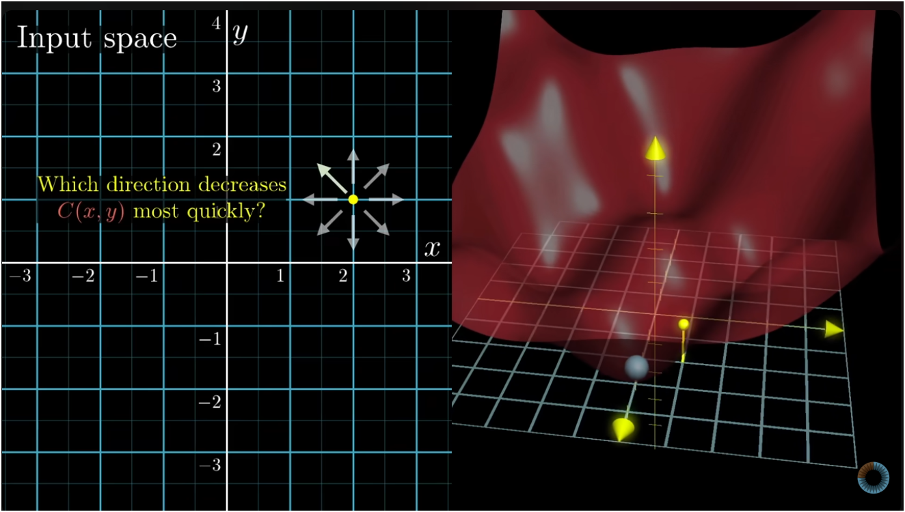

# Gradient Descent & Cost Functions

## Training Data & The Learning Loop
Using a dataset's inputs and labels to train the model to make predictions by adjusting weights and biases:
1. **Forward Propagation (Making a Prediction):** A mini-batch of input nodes crosses the connected layers of neurons—affected by weighted sums, activations of the said nodes, and biases—making its way to the final prediction.
2. **Calculate Error (Loss Computation):** Once output is made, the network compares its prediction to the true label using a **Cost / Loss Function** to calculate the output error.
3. **Calculate Adjustments (Backpropagation):** Applies the calculus **chain rule** backward from the output layer—nudging nodes by altering the past layer's weights and biases all the way back to the input layer to find how every weight and bias affects the error.
4. **Update Parameters (Gradient Descent):** Adjusts all connection weights and biases in the opposite direction of the gradients (taking a downhill step) to reduce the error.
5. **Repeat** until the error is small enough.

---

## Cost Function (Measuring Error)
The cost function calculates the total error of the model—measuring how "lousy" the model is.
* Takes **all weights and biases** across the entire network as inputs, and returns a **single number** measuring error.
* If the model's predictions are accurate and confident, cost is close to $0$. If predictions are wrong, cost is high.

### Formula (Mean Squared Error):
* Error on a single training example:
  $$C_{\text{example}} = \sum (a_{\text{output}} - y_{\text{label}})^2$$
* Total cost is the average over all $N$ training examples:
  $$C(W, b) = \frac{1}{N} \sum_{k=1}^N C_k$$

---

## Gradient Descent
Gradient descent updates the weights and biases to reduce the cost function.

### Direction of the Gradient:
* In calculus, the gradient ($\nabla C$) points in the direction of **steepest ascent** (uphill / biggest increase in cost).
* To reduce error, we step in the opposite direction: the **negative gradient ($-\nabla C$)** points in the direction of **steepest descent** (downhill).

### Parameter Update Rule:
$$\theta_{\text{new}} = \theta_{\text{old}} - \alpha \, \nabla C$$

* $\theta$: Vector of all weights and biases.
* $\alpha$: **Learning rate** (step size). Determines how big of a step to take downhill.
* **Automatic step sizing:** When the slope is steep, $|\nabla C|$ is large (takes bigger steps). Near the bottom where it flattens out, the slope nears $0$, naturally shrinking step sizes to prevent overshooting.

---

## Visualizing the Cost Landscape

### 1D Curve: Local vs. Global Minimum
To minimize the cost function, we step downhill—though we might not reach the absolute lowest point, but rather a local low point:

* **Horizontal axis ($w$):** Value of a single weight.
* **Vertical axis ($C(w)$):** The resulting cost.
* **Local vs. Global:**
  * The lowest valley overall is the **global minimum** (blue circle on the left).
  * The shallower dips are **local minima** (green circles on the right).
  * Since gradient descent only follows the immediate slope beneath it, random initial weights determine which valley the model ends up in.

---

### Multidimensional Optimization: Finding the Downhill Direction
Gradient descent finds the fastest way down the curve in multi-parameter space:

* **Left (Input / Parameter Space):** Shows a 2D parameter plane $(x, y)$. From any point, the negative gradient points in the exact direction that decreases $C(x, y)$ most quickly.
* **Right (Cost Surface in 3D):** Shows the cost plotted as a surface height. Gradient descent acts like a ball rolling down into the lowest valley.
* **In a real network:** This doesn't happen in 2D or 3D, but across thousands of parameters at once. The negative gradient is a multi-dimensional vector that nudges every weight and bias simultaneously.

---

## Batch vs. Mini-Batch SGD (In Practice)
With large datasets (e.g., 60,000 images in MNIST), how do we compute the gradient?
> **Core Idea:** We shuffle the data into mini-batches, then compute a step for each mini-batch—and each mini-batch aids us in getting downhill toward the lower point in the cost landscape. This is called **Stochastic Gradient Descent (SGD)**.

* **Batch Gradient Descent:** Computes error over all 60,000 images before taking one step $\rightarrow$ exact, but very slow.
* **Pure Stochastic Gradient Descent (SGD):** Takes a step after checking just 1 random image $\rightarrow$ very fast, but erratic and noisy.
* **Mini-Batch SGD (Standard Practice — often just called "SGD"):** Shuffles the data into small mini-batches (e.g., 32, 64, or 100 images) and computes a downhill step for each mini-batch $\rightarrow$ fast, computationally efficient on GPUs, and the slight randomness helps escape shallow local minima.

---

## Notes on Multilayer Networks & Noise
* **Why basic MLPs struggle with noise:** Feeding raw pixels into a standard multilayer network makes it susceptible to random static noise because it memorizes fixed pixel positions rather than spatial geometry.
* **Are MLPs outdated?**
  * Standalone MLPs on raw images were superseded by **CNNs** (for vision) and **Transformers** (for text and general tasks).
  * However, MLP feed-forward layers remain essential building blocks inside modern architectures (Transformers, CNN projection heads).
  * The fundamental engine—**Cost Functions + Gradient Descent + Backpropagation**—is the universal training method across all modern deep learning.
