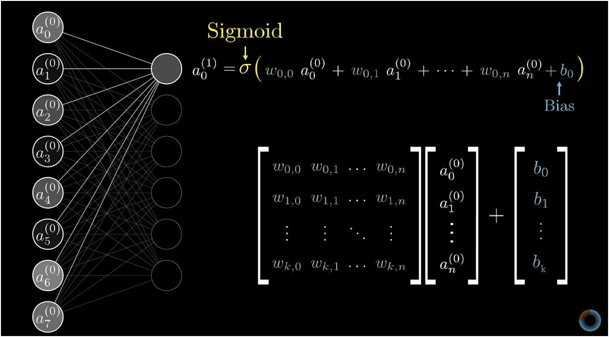

# Neural Network

## Neurons
Neorons process inputs by weighting sum and applying activation function. 
Neurons are things that hold numbers between 0 and 1, called **activations**.

* *Note on parameters:* Neurons only store their **activation**. The **weights** live on the connections between neurons, and **biases** belong to the neuron as an activation threshold.

---

## Layers & What to Expect from Them
Layers are groups of neurons that hold activation values at a given stage:
* **Input Layer:** Raw inputs (e.g., $28 \times 28 = 784$ pixel activations).
* **Hidden Layers:** Intermediate layers where feature extraction happens.
* **Output Layer:** Final choices (e.g., 10 neurons for digits 0–9; the highest number is the network's prediction).

### What do we expect from layers?
Layers break down complex inputs into smaller parts, and subsequent layers assemble them together to make sense of the inputs (**hierarchical feature abstraction**):
* **First layers:** Detect simple local features like edges and contrasts.
* **Middle layers:** Detect shapes and patterns (loops, corners, strokes).
* **Late layers:** Combine shapes into recognizable parts (eyes, ears, nose, tail, or digit strokes).
* **Last layer:** Combines parts to classify the input (e.g., combining a top loop and bottom stroke to identify a '9').

---

## Weights, Biases, and Neuron Activation
Weights connect the neurons of one layer to the neurons of the next:
* **Weights ($w$):** Each connection has a weight.
  * Positive weight = active incoming neuron *excites* this neuron.
  * Negative weight = active incoming neuron *inhibits* / suppresses this neuron.
* **Weighted Sum:**
  $$a_1 w_1 + a_2 w_2 + a_3 w_3 + \dots = \sum a_i w_i$$
  In vector form: $\mathbf{w} \cdot \mathbf{a} + b$
* **Bias ($b$):** The value we use to increase or decrease the threshold for the neuron to activate instead of just above zero.
  * *Example:* If we only want the neuron to fire when the weighted sum is meaningfully high (e.g., $> 10$), we set a negative bias like $b = -10$.

---

## Activation Functions: Sigmoid vs. ReLU
To squash the weighted sum + bias into a final activation value, we pass it through an **activation function**:

### 1. Sigmoid ($\sigma$)
$$\sigma(z) = \frac{1}{1 + e^{-z}}$$
* Squashes any real number $(-\infty, +\infty)$ into $(0, 1)$.
* **Purpose:** Smooth S-curve mimicking a biological neuron gradually firing.
* **Problem (Vanishing Gradient):** At very high or low values, the curve flattens out and the derivative (slope) approaches $0$. During backpropagation across multiple layers, multiplying these tiny slopes causes early layers to stop learning.
* **Modern usage:** Mostly reserved for the **output layer in binary classification**.

### 2. ReLU (Rectified Linear Unit)
$$\text{ReLU}(z) = \max(0, z)$$
* If $z \le 0 \implies 0$
* If $z > 0 \implies z$
* **Why modern deep learning uses it:**
  * **No vanishing gradient:** Slope is a constant $1$ for all positive inputs.
  * **Very fast:** Simple `max(0, z)` threshold, no expensive exponential math.
  * **Sparse:** Neurons with negative input stay at $0$.
* **Modern usage:** Standard default choice for **hidden layers**.

---

## Modeling a Layer: Matrix Representation
Instead of computing one neuron at a time, we model the entire layer together using linear algebra:

### For a single neuron:
$$a_0^{(1)} = \sigma\left( w_{0,0} a_0^{(0)} + w_{0,1} a_1^{(0)} + \dots + w_{0,n} a_n^{(0)} + b_0 \right)$$

### For the full layer all at once (Vectorized):
$$\mathbf{a}^{(1)} = \sigma\left( \mathbf{W} \mathbf{a}^{(0)} + \mathbf{b} \right)$$

* **$\mathbf{W}$ (Weight Matrix):** Each row contains all incoming connection weights for one neuron in the new layer.
* **$\mathbf{a}^{(0)}$ (Activation Vector):** Column vector of activations from the previous layer.
* **$\mathbf{b}$ (Bias Vector):** Column vector holding the bias for each neuron in the new layer.
* **$\sigma$ (Activation Function):** Squashes each element of the resulting vector to produce the new activations $\mathbf{a}^{(1)}$.

---

## What Does "Learning" Mean?
Learning is telling the computer to sort out the suitable weights and biases in order to produce a good output.
* The network starts with random weights and biases (guessing randomly).
* It measures its error using a **Cost Function**, and adjusts every weight and bias using **Gradient Descent** and **Backpropagation** until the error is minimized.

