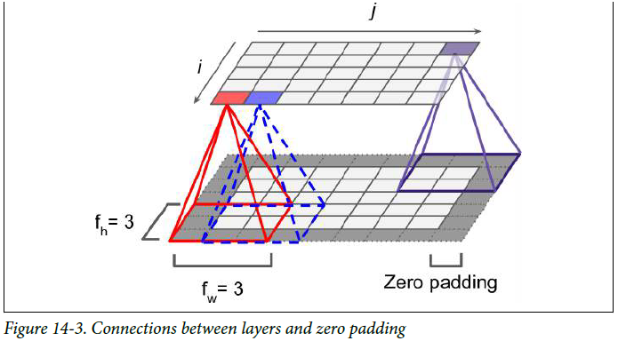

# Convolutional Neural Networks (CNNs)

## Why Regular Neural Networks (MLPs) Fail on Larger Images?
Cause every pixel connects to every neuron—where a `100 × 100` small image goes up to damn `10k` pixels, connected to `1,000` neurons, creating **10 million weights** in the first layer only.

* **How CNN solves it:** By using **partially connected layers** and **sharing weights** across the entire image.

---

## 1. The Convolutional Layer & Receptive Fields
The most important building block of a CNN is the **convolutional layer**:
* Instead of connecting neurons to every single pixel, each neuron looks at a small window of pixels called a **receptive field**.
* The **first layer** looks at tiny patches across the image (to detect simple edges and lines).
* The **second layer and beyond** connects to small clusters of neurons from the previous layer, assembling those small pieces into bigger shapes and features.

---

## 2. Stride & Padding

### Stride
The shift from one receptive field to the next is called **stride**—where a step size decides how many pixels the receptive field window moves across the entire image:
* **Stride = 1:** The filter moves pixel by pixel.
* **Stride = 2:** The filter skips every other pixel, cutting the spatial dimensions (height and width) roughly in half.

### Padding
While **padding** is concerned about how to treat the boundaries of the image/layer:
* **`"valid"` padding:** No padding added. The filter stops when it hits the edge, causing the output feature map to be slightly smaller than the input.
* **`"same"` padding:** Zeroes are added symmetrically around the border so the output has the exact same height and width as the input.

---

## 3. Filters & Feature Maps
* **Filter:** A small grid of weights trained to look for one specific pattern, which could be only vertical or horizontal lines.
* **Feature Map:** When sliding one filter across the whole image as one layer above the input. They efficiently share the same weight.
* **Stacking Feature Maps:** When we put several feature maps on top of each other to further analyze the image features from several different perspectives.

---

## 4. Pooling Layer
* **What it does:** Subsamples or shrinks the input image to reduce the computational load.
* **How it works:** Pooling connects to a small number of neurons and also has its own **receptive field, padding, and strides** too.
* **No weights:** Unlike convolutional layers, pooling layers **don't have weights**—instead, they aggregate the inputs using functions such as **max** or **mean**. If we pick **max**, we drop the other inputs from the same receptive field.
* **Invariance:** Alongside reducing computational cost, parameters, and memory, using **max** as the aggregate function also gives **shift invariance** (less sensitivity to small shifts in position).

> **Max vs. Mean Pooling:** Surprisingly, the **max** aggregate function does better than **mean** as it displays the strongest feature among the inputs while dropping noise and jitter, whereas **mean** loses less info overall.

---

## 5. CNN Architectures & Evolution

Typical CNN architectures stack a few convolutional layers (each one generally followed by a `ReLU` layer), then a pooling layer, then another few convolutional layers (`+ReLU`), then another pooling layer, and so on. The image gets **smaller and smaller** as it progresses through the network, but it also typically gets **deeper and deeper** (i.e., with more feature maps) thanks to the convolutional layers.

> **Kernel Size Rule of Thumb:** It's better to use smaller dimensions for convolutional filters—specifically, stacking two `3 × 3` layers instead of one `5 × 5` layer—as it uses fewer weights (parameters), has less computational cost, and usually performs better.
>
> **The One Exception (First Layer):** In the very first convolutional layer, you can use a larger `5 × 5` filter with a stride of `2` or more. Since the raw input image only has 3 channels (RGB), it isn't too costly, and the wider `5 × 5` window lets you shrink the image size early while still preserving information.

### 1. LeNet-5 (1998 — The Pioneer)
* **What it did:** Built by Yann LeCun to read handwritten digits on bank checks (MNIST).
* **How it worked:** `Conv => AvgPool => Conv => AvgPool => Dense => Output`.
* **Its Limitation:** Used **Tanh/Sigmoid** activations and **Average Pooling**—so if you tried to stack more layers, gradients vanished and features got blurred out.

### 2. AlexNet (2012 — Scaling Up to Real Photos)
* **What it did:** Crushed the 2012 ImageNet competition, proving deep CNNs work on large, real-world color photos.
* **How it fixed LeNet-5:**
  1. **Switched to ReLU & Max Pooling:** Stopped vanishing gradients ($\approx 6\times$ faster training) and kept the sharpest features instead of blurring them with Average Pooling.
  2. **Stacked Conv layers directly** on top of each other before pooling.
  3. **Fought overfitting** using **50% Dropout** and **Data Augmentation** (randomly flipping, cropping, and shifting lighting on images so the model doesn't just memorize them).
* **Its Limitation:** Ended with two giant `Dense` layers (`4,096` neurons each) that hogged over 90% of the weights, and you still couldn't stack 30+ layers without the signal getting lost.

### 3. ResNet (2015 — Going 100+ Layers Deep with Shortcuts)
* **The Problem:** When you stack too many layers (30+ layers), training actually gets *worse* because signals and gradients fade out trying to pass through dozens of layers.
* **How it fixed AlexNet (Skip / Shortcut Connections):**
  * Instead of forcing every layer to pass information only through its weights, ResNet adds a **shortcut (skip connection)** that jumps over a block of layers and adds the original input $x$ straight to the block's output:
    $$\text{Output} = F(x) + x$$
* **Why this works:**
  * Even if a block of layers hasn't learned anything yet (weights $= 0$), the original signal $x$ still passes right through the shortcut untouched.
  * During backpropagation, gradients travel straight back along the shortcut like a highway without vanishing—making **100+ layer networks** possible.

---

## 6. Quick Practical Tips
* **Use `GlobalAveragePooling2D()` instead of huge Dense layers:** Rather than flattening large feature maps into massive Dense layers with millions of weights (like AlexNet did), place `GlobalAveragePooling2D()` right before the final `Softmax` layer.
* **Stack `3 × 3` filters instead of `5 × 5`:** Uses fewer weights, less compute, and performs better (except in the very first layer where a `5 × 5` filter with `stride = 2+` helps shrink the image early).
* **Double filters after each Pooling layer:** Since pooling cuts height and width in half, you can safely double the feature maps (`64 => 128 => 256`) without exploding memory.
* **Skip connections are everywhere now:** ResNet's shortcut idea ($\text{Output} = F(x) + x$) works so well that it is also a core building block inside modern **Transformers and LLMs**.

---

## 7. Data Augmentation & Transfer Learning

### Data Augmentation
Generating more training variations from existing images to combat overfitting (a regularization technique)—usually by **rotating, flipping, cropping, or shifting** the image to produce realistic new training data.
* *Note:* Adding random white noise doesn't help, as transformations must be realistic changes that still represent the same object in the dataset.

---

### Transfer Learning
The technique of reusing a **pre-trained model** (trained on a massive dataset) on a new dataset (like a smaller local dataset you have), instead of training from scratch which consumes huge computation and time.

**Why it works (What the layers already know):**
* **Early layers (Body):** Edges, corners, curves, lines.
* **Middle layers (Body):** Shapes, textures, patterns.
* **Late / Final layers (Head):** Full objects and the final classification output (what the image actually is).

Since the early and middle layers (**the body**) already know how to see edges and shapes, we keep them and only swap out the final output layer (**the head**):

**The 3 Steps:**
1. **Swap the Head:** Take off the pre-trained model's old output layer (e.g., 1,000 classes) and attach our own new output layer (e.g., 5 classes for our dataset).
2. **Freeze the Body & Train Only the New Head:** Lock all pre-trained layers so their weights can't change, and train *only* our newly attached head for a few epochs *(because our new head starts with random weights, its early errors are huge—if we didn't lock the body first, backpropagation would ruin the pre-trained weights)*.
3. **Fine-Tune (Unfreeze Upper Body + Low Learning Rate):** Now that the new head is trained, unlock the last few layers of the pre-trained body and train them on our dataset using a **very low learning rate** so we gently adapt them without ruining their pre-trained weights and judgment.

**When to Use What:**
* **Small dataset (similar to original):** Only do Steps 1 & 2 (keep the body frozen, just train the new head).
* **Medium dataset:** Do all 3 steps (train the head first, then unfreeze and fine-tune the top few layers).
* **Massive dataset:** Unfreeze and train the whole model (pre-trained weights still give a much faster head start than random weights).

---

## 8. End-to-End Image Classification Pipeline
An **Image Classification Pipeline** is the full assembly line that takes raw image files from disk and outputs predicted class probabilities:

### 1. Ingestion & Preprocessing
* Loading raw images directly into a neural network isn't doable when image sizes are inconsistent—first they get **resized and cropped** to the same size.
* Then they get **normalized and rescaled**, usually by dividing pixel values by `255` to get values between `0` and `1` (or `-1` to `1`).
* **Performance (`tf.data`):** Images are **shuffled**, grouped into **mini-batches**, and **prefetched** (while batch $N$ is being processed on the GPU, batch $N+1$ is already being prepared in RAM).

### 2. Data Augmentation
* Inserted directly into the pipeline to artificially expand the dataset and prevent overfitting.
> **Important:** Data augmentation runs **only during training**. During validation and testing, images are strictly resized and normalized without random distortions.

### 3. Feature Extractor (The Body)
* Passes the image through the **Convolutional + ReLU + Pooling** layers.
* Instead of outputting a final class, the body outputs a **3D stack of small 2D feature maps** (where each map highlights whether a specific pattern—like ears, wheels, or petals—was found).

### 4. Classification Head (Turning Feature Maps into a Final Answer)
The final output layer (`Dense`) **cannot read 2D grids**—it only accepts a flat 1D list of numbers. So the Classification Head converts that stack of 2D feature maps into a final prediction in 4 steps:
1. **`GlobalAveragePooling2D` (Squash Grids into 1 List):** Takes the average of each 2D feature map so every map becomes **1 single number** (turning a stack of 2048 grids into a flat list of 2048 numbers—one score per feature).
2. **`Dropout`:** Randomly turns off some connections during training so the model doesn't memorize the training data.
3. **`Dense` Layer:** Connects that flat list of features to your final class neurons (e.g., `5` neurons for `5` classes).
4. **`Softmax` Activation:** Converts those final neuron scores into percentages (probabilities) that add up to `1.0` (`100%`).

### 5. Training, Evaluation & Fine-Tuning
* **Phase A (Train the Head First):** Keep the Feature Extractor (body) **frozen**, and train only the new Classification Head for a few epochs (using `Adam` + `Cross-Entropy` loss).
* **Phase B (Fine-Tuning):** Unfreeze the top few layers of the body, drop the learning rate very low (e.g., $10^{-5}$), and train again to gently adapt the high-level filters to your specific dataset.

---

## 9. Recurrent Neural Networks (RNNs), LSTM & GRU

### Why Recurrent Neural Networks (RNNs) Exist?
* Cause MLP and CNN still suffer from limitations—they assume inputs come in a **fixed size** (for images especially), are **independent**, and have **no memory** of what came before.
* **How RNN works:** RNN processes **sequential data** (stock prices, time series, text) as it has a **feedback loop** that passes information from one step to the next.
* **The Problem (Short-Term Memory):** Backpropagating through time results in a **vanishing gradient**, which means a basic RNN forgets memories `+10` steps behind.

---

### 1. LSTM (Long Short-Term Memory) — Solving the Memory Problem
Invented to give neural networks a dedicated **long-term memory track (cell state)** alongside the short-term **hidden state**. It uses **3 gates** to control information flow:
* **Forget Gate:** Decides what percentage of old memories to throw away.
* **Input Gate:** Decides which new information from the current step is worth storing in the long-term cell state.
* **Output Gate:** Decides what parts of the internal cell state should be output as the hidden state ($h_t$) for the next step.

---

### 2. GRU (Gated Recurrent Unit) — The Simplified Modern Cousin
A streamlined version of the LSTM that **merges the cell state and hidden state into one**, replacing the 3 gates with just **2 gates**:
* **Reset Gate:** Decides how much of the past state to forget.
* **Update Gate:** Acts as both the **forget gate** and **input gate** simultaneously (deciding how much old memory to keep vs. how much new info to add).

**Advantage:** Fewer parameters, faster to train, and often performs just as well as an LSTM.
